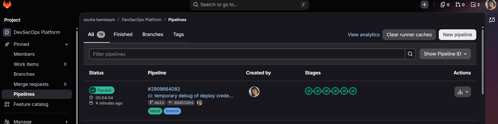
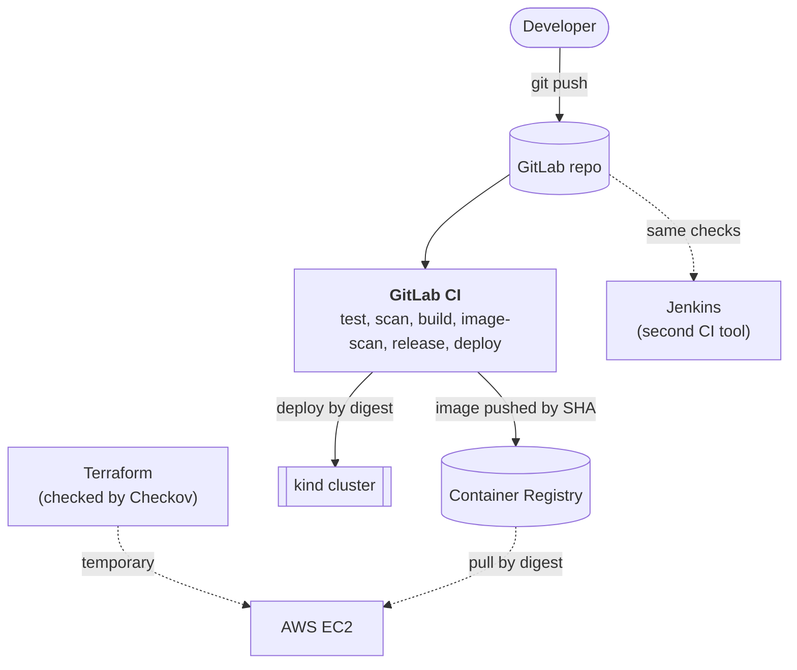

# DevSecOps Platform

A secure delivery pipeline around a small Flask app (Task Tracker). Every commit is tested,
scanned for secrets, code flaws, vulnerable dependencies and misconfigured infrastructure,
packaged as a hardened container image, and deployed to Kubernetes. The same image also ran
on a temporary AWS server created with Terraform.

The app is deliberately simple. The project is about the pipeline: a change that fails a
security check never reaches the registry's `latest` tag or the cluster.



## How it works



Full diagrams: [docs/00-architecture.md](docs/00-architecture.md).

## Tools

| Purpose | Tool |
|---|---|
| App, tests | Flask, gunicorn, pytest (49 tests, 100% coverage, 90% gate) |
| Container | Docker, multi-stage, non-root, healthcheck |
| CI/CD | GitLab CI, self-hosted runner, Jenkins |
| Secrets | Gitleaks |
| Code flaws (SAST) | Semgrep |
| Dependencies and image | Trivy, SBOM in CycloneDX |
| Dockerfile lint | Hadolint |
| Infrastructure as code | Checkov (Dockerfile, Kubernetes, Terraform), Terraform |
| Orchestration | Kubernetes (kind), Pod Security `restricted`, NetworkPolicy, least-privilege deploy account |
| Cloud | AWS EC2 through Terraform (Learner Lab) |

## Pipeline

| Stage | Jobs | Fails when |
|---|---|---|
| test | pytest | A test fails or coverage drops below 90% |
| scan | gitleaks, semgrep, trivy-deps, hadolint, checkov | A secret, code flaw, vulnerable dependency or insecure config is found |
| build | Docker build, push by commit SHA | The build fails |
| image-scan | Trivy image, SBOM | A CRITICAL fixable vulnerability is in the image |
| release | Tag `latest` | Only runs on `main` |
| deploy | `kubectl apply` of the exact image digest | Only runs on `main` |

Each scanner was proven to block a bad change on a throwaway branch (fake secret, `eval`,
vulnerable dependency, root container, SSH open to the world). Screenshots are in the docs.

## Try it

Run the app locally:

```
docker build -t task-tracker:1.0 .
docker run -d --name tt -p 8000:8000 -v tt-data:/data task-tracker:1.0
# open http://localhost:8000
```

Run the tests:

```
pip install -r requirements-dev.txt
python -m pytest --cov=app
```

The Kubernetes, runner, Jenkins and AWS steps need setup of their own and are described
step by step in the docs below.

## Repository layout

```
app/            Flask application
tests/          pytest suite
Dockerfile      hardened two-stage image
.gitlab-ci.yml  GitLab pipeline
Jenkinsfile     same checks in Jenkins
jenkins/        Jenkins image (pinned version, plugins)
k8s/            manifests, NetworkPolicy, bootstrap RBAC for the deploy account
terraform/      AWS server, firewall and first-boot script
docs/           one document per phase
```

## Documentation

| Doc | Topic |
|---|---|
| [00](docs/00-architecture.md) | Architecture diagrams and security controls by layer |
| [01](docs/01-setup-and-app.md) | Environment, the application, tests |
| [02](docs/02-docker.md) | Dockerfile and image hardening |
| [03](docs/03-ci-pipeline.md) | CI pipeline: test, build, registry |
| [04](docs/04-security-scanning.md) | Security scanners and proof they block |
| [05](docs/05-kubernetes.md) | Kubernetes with kind, hardening, NetworkPolicy |
| [06](docs/06-automatic-deploy.md) | Automatic deploy with a least-privilege account |
| [07](docs/07-terraform.md) | Terraform and infrastructure scanning |
| [08](docs/08-jenkins.md) | Jenkins as a second CI tool |
| [09](docs/09-aws-deployment.md) | Running the image on AWS, then destroying it |

## Known limits

- The AWS run used plain HTTP (no domain, so no certificate) and a deploy token that ends up
  in Terraform state and boot data. Both are explained in doc 09.
- The app has no CSRF tokens or security headers. A DAST scan (OWASP ZAP) would report them.
- The deploy runs on a self-hosted runner on a laptop, which suits a demo, not production.
- SQLite allows one writer, so the app runs a single replica.
