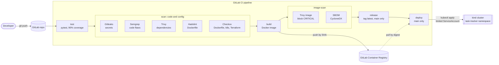
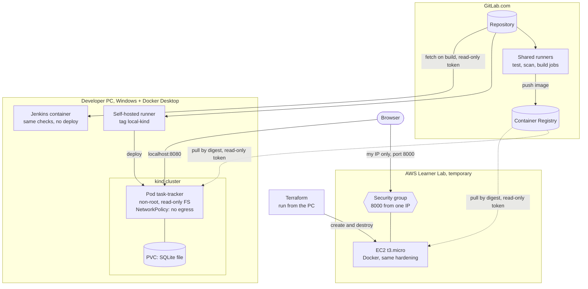

# Architecture

One small app (Task Tracker) goes through a pipeline that tests it, scans it, packages it
and deploys it. The same code can also be built by a second CI tool (Jenkins) and run on a
temporary AWS server. The diagrams render directly on GitLab.

## 1. The pipeline: from commit to running app

Any red job stops the stages after it, so a vulnerable or leaky change never reaches the
registry's `latest` tag or the cluster. Each scanner was proven to fail on a throwaway
branch (docs 04, 05 and 07).

## 2. Where everything runs

Why it is split this way:

| Part | Where | Why there |
|---|---|---|
| Test, scan, build | GitLab shared runners | Free, clean machine for every job |
| Deploy to kind | Self-hosted runner on the PC | GitLab's cloud cannot reach a cluster inside the PC |
| Jenkins | Container on the PC | Shows the same checks in a second CI tool. Never started together with kind, to save RAM |
| AWS server | Terraform from the PC | Lab credentials are temporary, so no pipeline holds them. Destroyed the same day |

## 3. Security controls by layer

| Layer | Control | Tool or setting | Doc |
|---|---|---|---|
| Code | Secret detection | Gitleaks | 04 |
| Code | Static analysis | Semgrep | 04 |
| Dependencies | Known CVEs, SBOM | Trivy, CycloneDX | 04 |
| Container | Lint, scan, non-root, healthcheck | Hadolint, Trivy image, Dockerfile | 04 |
| Kubernetes | PSA restricted, read-only FS, dropped capabilities, NetworkPolicy, image pinned by digest | Manifests, Checkov | 05, 06 |
| Deploy access | Least privilege | `ci-deployer` ServiceAccount limited to one namespace, no delete | 06 |
| Infrastructure | Scanned before creation | Checkov on Terraform, `/32` validation, IMDSv2, encrypted disk | 07 |
| Cloud | One-IP firewall, no SSH, read-only registry token | Security group, boot script | 09 |
