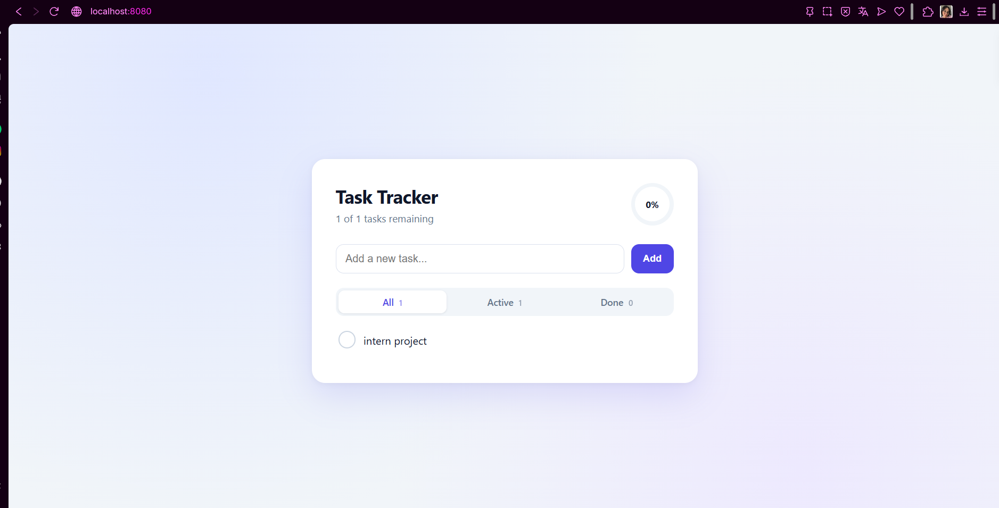

# Phase 1: Setup and the application

The platform needs something to protect. The app is deliberately small, so the focus
stays on the pipeline around it: a **Task Tracker** written in Flask.



## Environment

| Part | Choice | Why |
|---|---|---|
| OS | Windows 11, 8 GB RAM | The machine available. Docker and WSL2 are capped at 4 GB (`.wslconfig`), so Kubernetes and Jenkins are never run together |
| Containers | Docker Desktop (WSL2 engine) | Build and run images locally |
| Language | Python 3.12 | Same version as the Dockerfile |
| Source control | Git, hosted on GitLab (private project) | Repository, CI and container registry in one place |

## What the app does

Add, edit, complete and delete tasks, filter them (all, active, done), and see a progress
ring. Tasks are stored in a single SQLite file.

| Route | Purpose |
|---|---|
| `GET /` | The page (filters with `?filter=active` or `done`) |
| `POST /add`, `/edit/<id>`, `/toggle/<id>`, `/delete/<id>` | Form actions, then redirect back |
| `GET /api/tasks`, `POST /api/tasks`, `PUT /api/tasks/<id>` | JSON API |
| `GET /health` | Returns `{"status": "ok"}`, used by Docker and Kubernetes probes |

## Code layout

```
app/
  __init__.py      application factory: builds and wires the Flask app
  config.py        settings read from the environment (DB_PATH, title length)
  db.py            connection handling only
  repository.py    all SQL in one place
  routes/          web.py (pages), api.py (JSON), health.py
  templates/       index.html, base.html
  static/          css and js
wsgi.py            entry point for gunicorn
tests/             pytest suite
```

Design choices that matter for the rest of the project:

- **Settings come from the environment.** `DB_PATH` decides where the database file lives,
  so the same image can write to a Docker volume, a Kubernetes volume or a local folder.
- **All SQL is in `repository.py`** and uses parameters, never string concatenation, so
  there is no SQL injection to find.
- **Jinja2 auto-escapes** page output, so a task title with HTML in it is shown as text.
- **SQLite means exactly one writer.** That is why Kubernetes runs one replica with the
  `Recreate` strategy (doc 05).

## Tests

`pytest` with 49 tests and 100% line coverage. They cover the repository, the JSON API, the
pages and the health check. Writing them found a real bug: a JSON body that was valid but
not an object (for example `[1,2]`) caused a 500 error. It now returns a clean 400.

```
python -m pytest --cov=app
```

The pipeline enforces a 90% coverage floor (doc 03).

**Known gaps, accepted:** the app has no CSRF tokens and sets no security headers (CSP,
`X-Frame-Options`), and the JavaScript, concurrency and unicode cases are not tested. These
are application-level hardening items, outside the scope of the delivery pipeline, and are
exactly what a later DAST scan (for example OWASP ZAP) would report.

## Repository

Git was initialised here, a `.gitignore` keeps virtual environments, databases and secrets
out, and the first commit went to a private GitLab project. Every later phase is one
small commit, so the history shows how the platform was built.
