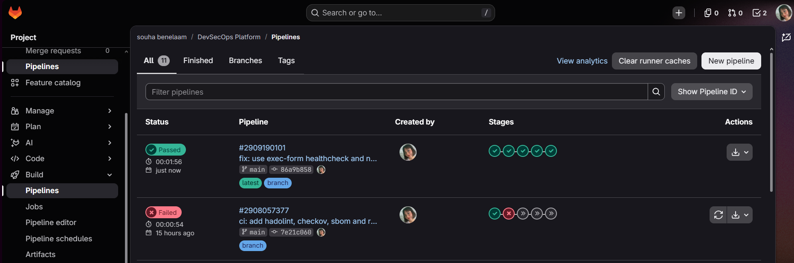

# Phase 3: CI pipeline (test, build, registry)

The pipeline lives in `.gitlab-ci.yml` and runs on every push. Each stage only starts
if the previous one passed, so a broken build never reaches the registry.

```
test -> scan -> build -> image-scan -> release
```



## Design decisions

| Decision | Why |
|---|---|
| Every tool image is pinned to an exact version | A new release of a scanner can't change results or break the pipeline without a commit. |
| One image tag per commit (`$CI_COMMIT_SHORT_SHA`) | Any image in the registry traces back to the commit that built it. |
| `build` pushes the SHA image, scans pull it, `release` adds `latest` | `latest` only ever points at an image that passed every scan. No separate push stage is needed. |
| `latest` is only set on `main` | Test and feature branches never overwrite the release tag. |
| No credentials in the repo | The registry login uses `CI_REGISTRY_USER` / `CI_REGISTRY_PASSWORD`, which GitLab fills in per job. |

## Stage: test

- Runs `pytest` on `python:3.12-slim`, the same Python version as the Dockerfile.
- Coverage gate: `--cov-fail-under=90`. The job fails if coverage drops below 90%.
  Current state: 49 tests, 100% line coverage.
- The pip cache is keyed on `requirements-dev.txt`, so it is rebuilt only when
  dependencies change.
- The `coverage:` regex lets GitLab show the coverage number on the job.

Known gaps in the tests, accepted for now: CSRF, security headers, the JavaScript
front end, concurrency and unicode input.

## Stage: build

- Docker-in-Docker: the `docker:27` client talks to the `docker:27-dind` service.
- Builds the Dockerfile and pushes `registry.gitlab.com/souhabenelaam/devsecops-platform:<sha>`.

## Stage: release

- Runs only on `main`, after every scan has passed.
- Pulls the scanned SHA image, tags it `latest` and pushes it. Same bytes, second name.

## Local check of the registry image

The image built locally from the Dockerfile was run as a container and verified:

- `docker ps` shows `(healthy)`, so the exec-form `HEALTHCHECK` works.
- `docker exec <container> id` shows `uid=10001(app)`, so the container is not root.
- `/health` returns HTTP 200.
- The app starts with an empty database. The image contains no data. Tasks live in the
  `/data` volume.
