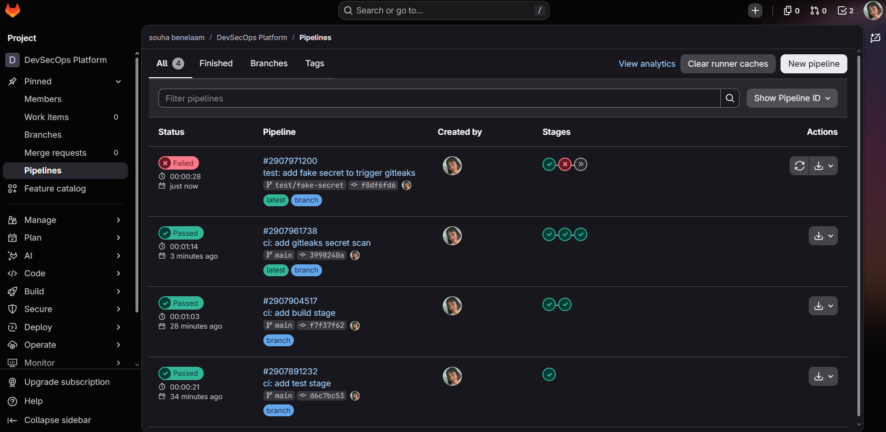
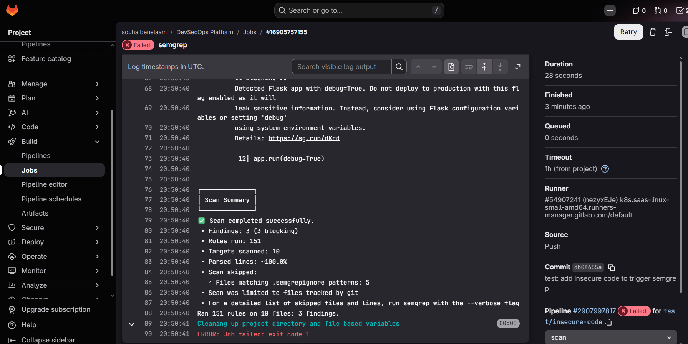
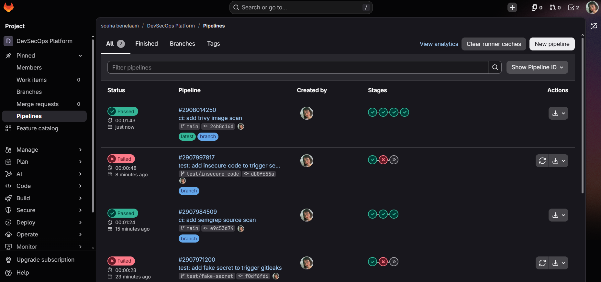
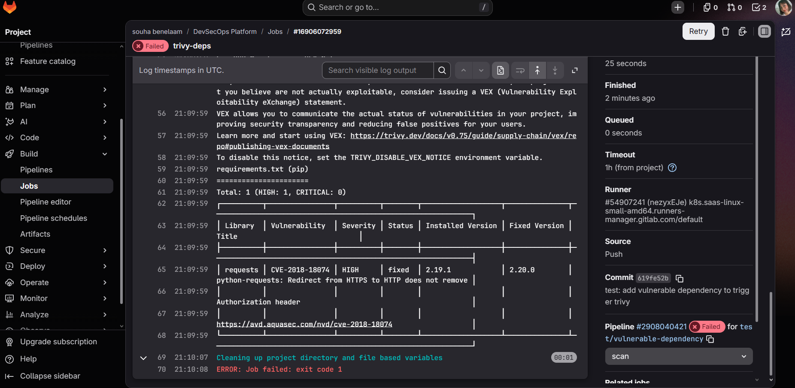

# Phase 4: Security scanning in the pipeline

Security checks run as pipeline jobs. A finding fails the job and blocks everything
after it. Each tool covers one kind of problem, and none of them duplicates another.

| Job | Stage | Tool (pinned) | What it catches | Fails on |
|---|---|---|---|---|
| `gitleaks` | scan | gitleaks v8.21.2 | Secrets committed to the repo, including old commits | any secret |
| `semgrep` | scan | semgrep 1.179.0 (`p/python`, `p/flask`) | Insecure code patterns (SAST) | any finding |
| `trivy-deps` | scan | trivy 0.75.0 | Known CVEs in `requirements.txt` | HIGH or CRITICAL with a fix |
| `hadolint` | scan | hadolint v2.15.1 | Dockerfile bad practice | warning or worse |
| `checkov` | scan | checkov 3.3.22 | Dockerfile misconfiguration (IaC) | any failed check |
| `trivy-image` | image-scan | trivy 0.75.0 | CVEs in the built image (OS and Python packages) | CRITICAL with a fix |
| `trivy-sbom` | image-scan | trivy 0.75.0 | Nothing, it produces a CycloneDX SBOM artifact | never |

Why these tools:
- **gitleaks** scans the full git history (`GIT_DEPTH: 0`), because a secret deleted in a
  later commit is still leaked.
- **semgrep** is the SAST tool. The `p/flask` pack adds Flask-specific rules such as
  `debug=True`.
- **trivy** is used three times: dependencies, the image, and the SBOM. One tool means one
  vulnerability database and one set of flags to learn.
- **`--ignore-unfixed`** hides CVEs that have no patch yet, because nobody can act on them.
- **trivy-image** prints HIGH and CRITICAL for visibility but only gates on CRITICAL. This
  keeps the report honest without blocking on issues in the base image that we don't control.

Left out on purpose as duplicates: bandit (semgrep covers it), pip-audit (trivy covers it)
and a second secrets scanner.

## Proof that the gates work

A scan that never fails proves nothing. Each of the first three scanners was tested on a
throwaway branch with a deliberate problem. All three failed the pipeline as intended.
The branches were deleted afterwards.

### gitleaks: fake secret

Branch `test/fake-secret`. Gitleaks fails the `scan` stage, and the later stages are
skipped (the double arrow icon). The `main` pipeline below it passed.

### semgrep: insecure code

Branch `test/insecure-code` added `eval` and `app.run(debug=True)`. Semgrep ran 151 rules and
reported 3 blocking findings. The log shows the Flask `debug=True` rule and the line that
triggered it.

The pipelines list below shows the same failure (`test/insecure-code`) between two green
`main` pipelines. The top one is the first run with the new `trivy-image` stage.

### trivy-deps: vulnerable dependency

Branch `test/vulnerable-dependency` pinned `requests==2.19.1`. Trivy reports
CVE-2018-18074 (HIGH, fixed in 2.20.0: the Authorization header is not removed on a
redirect from HTTPS to HTTP) and the job exits with code 1.

## A real failure, fixed: hadolint

The first full run on `main` (commit `7e21c06`) failed at `hadolint` with two findings on
the Dockerfile:

- **DL3025**: `HEALTHCHECK` used shell form. Fixed with exec form
  (`CMD ["python", "-c", "..."]`). The old `|| exit 1` is no longer needed, because Docker
  already treats a non-zero exit as unhealthy.
- **DL3066**: `USER app` by name. Fixed with `USER 10001:10001`. A numeric ID can be checked
  as non-root without reading `/etc/passwd`, which Kubernetes needs later for
  `runAsNonRoot`.

After the fix (commit `86a9b858`) the whole pipeline passed (first screenshot in
[03-ci-pipeline.md](03-ci-pipeline.md)).

## Reading the SBOM

`trivy-sbom` stores `sbom.cdx.json` as a job artifact for 30 days. Open the job in GitLab
and download it from the artifacts panel. It lists every package in the image, so the next
time a CVE is announced you can check whether the image is affected without rescanning.
