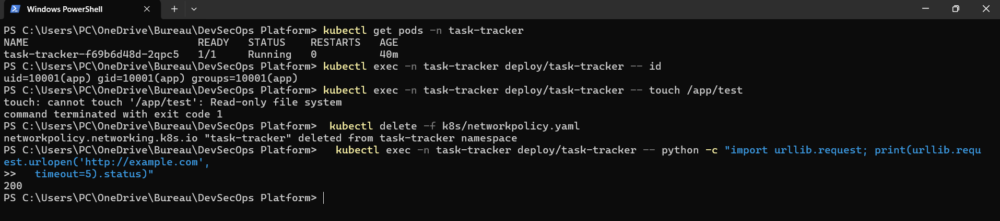
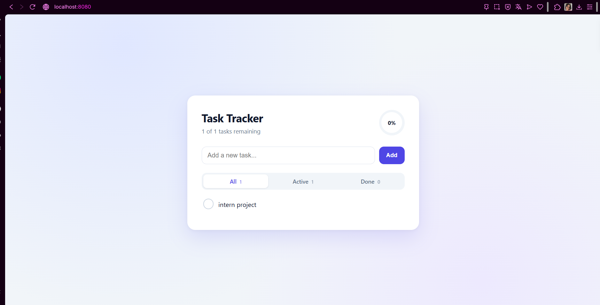
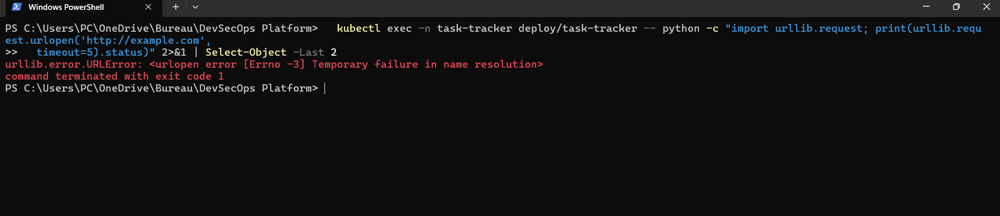
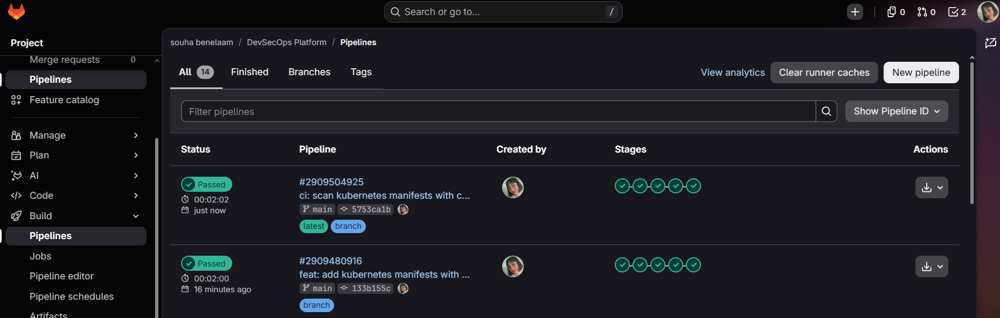
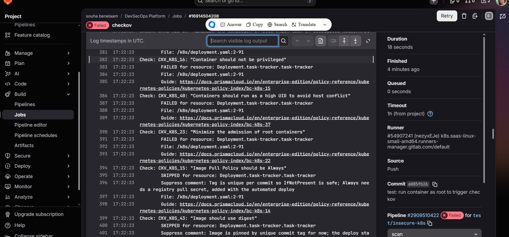

# Phase 5: Kubernetes (kind)

The scanned image from Phase 4 now runs in a local Kubernetes cluster. The security rules
are written in YAML files in `k8s/`, so they are reviewed in git and scanned by the pipeline.

## Why kind

kind runs a Kubernetes cluster inside Docker: each "node" is a Docker container. It is the
real Kubernetes API, so the manifests would run unchanged on a managed cluster.

| Option | Why not |
|---|---|
| Cloud cluster (EKS, GKE, AKS) | Costs money from the moment it exists |
| kubeadm on VMs | Needs several VMs, too heavy for an 8 GB machine |
| minikube | Works, but heavier than kind |

`k8s/kind-config.yaml` creates one node that is both control plane and worker, to save RAM.
It also publishes node port 30080 as `localhost:8080`, bound to `127.0.0.1` so only this
machine can reach the app.

```
kind create cluster --config k8s/kind-config.yaml
```

## The manifests

| File | Role |
|---|---|
| `namespace.yaml` | Own namespace `task-tracker`, with the Pod Security Admission label `enforce: restricted`. The cluster itself rejects any pod that breaks the restricted rules (root, privilege escalation, extra capabilities) |
| `pvc.yaml` | 1 GiB claim so `/data` (the SQLite file) survives pod restarts |
| `deployment.yaml` | The app and its security rules (below) |
| `service.yaml` | NodePort 30080 to container port 8000. Browser, kind port mapping, node port, Service, pod |
| `networkpolicy.yaml` | Firewall: inbound TCP 8000 only, no outbound traffic at all |

### Decisions in `deployment.yaml`

- **`replicas: 1` with `strategy: Recreate`.** SQLite is a single file. Two pods writing to it
  could corrupt it, and a rolling update would briefly run both.
- **Security context.** `runAsNonRoot`, `runAsUser: 10001` (same numeric id as the Dockerfile
  user), `allowPrivilegeEscalation: false`, `readOnlyRootFilesystem: true`, all capabilities
  dropped, `seccompProfile: RuntimeDefault`.
- **`emptyDir` on `/tmp`.** The root filesystem is read-only, and gunicorn needs a writable
  temporary folder.
- **`automountServiceAccountToken: false`.** The app never talks to the Kubernetes API, so
  there is no token to steal.
- **Resource requests and limits** so one pod cannot starve the node.
- **Readiness and liveness probes** on `/health`, with `timeoutSeconds: 3`.
- **Image tagged with the commit** (`86a9b858`), never `latest`.

## Verification

Each claim above was checked on the running cluster.



| Check | Command | Result |
|---|---|---|
| Healthy | `kubectl get pods -n task-tracker` | `1/1 Running`, 0 restarts |
| Not root | `kubectl exec ... -- id` | `uid=10001(app)` |
| Read-only filesystem | `kubectl exec ... -- touch /app/test` | `Read-only file system` |
| Data persists | delete the pod, reload the page | the task is still there |



### The network policy is enforced

The same test, run from inside the pod, with and without the policy:

- **Without the policy**, the request to `http://example.com` returns `200` (first screenshot,
  last line).
- **With the policy**, the pod cannot even resolve the name, because all outbound traffic is
  blocked:



A direct connection to an IP address, which skips DNS, also timed out.

**Limit of the inbound rule.** It restricts the port, not the sender. Browser traffic arrives
through the node port with a source address that is not predictable, so restricting it by
source would risk breaking access. The outbound rule is the stricter one.

## Scanning the manifests in CI

The `checkov` job now scans both frameworks:

```
checkov -d . --framework dockerfile --framework kubernetes --compact
```

Result on `main`: Dockerfile 92 passed, 0 failed. Kubernetes 88 passed, 0 failed, 2 skipped.



### Two documented skips

| Check | Asks for | Why skipped for now |
|---|---|---|
| `CKV_K8S_43` | Image pinned by digest | A locally loaded image has no registry digest. The deploy stage will write `image@sha256:<digest>` |
| `CKV_K8S_15` | `imagePullPolicy: Always` | The tag is unique per commit, so `IfNotPresent` is safe. `Always` needs a registry pull secret, which comes with the automated deploy |

Each skip is an annotation on the Deployment with its reason, and the skips appear in the job
log. Both are to be removed when the pipeline deploys.

### Proof that the gate works

A throwaway branch `test/insecure-k8s` set `runAsNonRoot: false`, `runAsUser: 0` and
`privileged: true`. The pipeline failed in the `scan` stage with three findings:

- `CKV_K8S_16` Container should not be privileged
- `CKV_K8S_40` Containers should run as a high UID to avoid host conflict
- `CKV_K8S_23` Minimize the admission of root containers



The branch was deleted afterwards.

## Known limits

- **No automatic deploy yet.** The manifests were applied by hand with `kubectl apply`, and the
  image was loaded into kind with `kind load docker-image`. GitLab's shared runners run in the
  cloud and cannot reach a cluster on a laptop. The deploy stage needs a self-hosted runner on
  this machine, which is planned.
- **One unexplained slow start.** Right after the first pod deletion, the pod answered `/health`
  too slowly for about three minutes, and the liveness probe restarted it once. It did not
  happen again in later restarts (ready in 13 seconds). Idle browser connections to the
  gunicorn `sync` workers were tested as a cause and rejected. The probe timeout was raised
  from 1 to 3 seconds as a precaution. The root cause is not known.
- **Inbound rule is port-only**, as described above.
