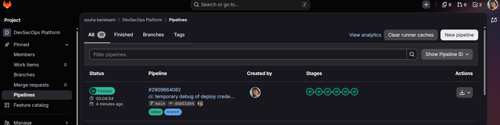
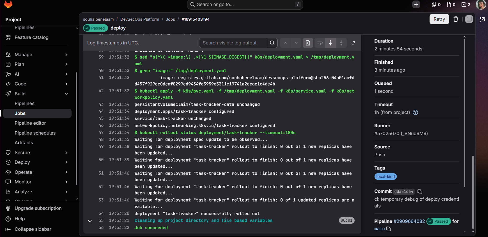

# Phase 6: Automatic deploy to Kubernetes

A push to `main` now travels all the way to the running cluster with no manual step:

```
test -> scan -> build -> image-scan -> release -> deploy
```



## The problem: the cloud cannot reach a laptop

GitLab's shared runners run in the cloud. The kind cluster runs on a laptop behind a home
network, so a cloud job cannot open a connection to it. The fix is a **self-hosted runner**
on the same machine as the cluster. It connects outward to GitLab ("any job for me?"),
which is allowed, and then runs the job locally, where the cluster is reachable.

## The self-hosted runner

| Setting | Value | Why |
|---|---|---|
| Image | `gitlab/gitlab-runner:alpine-v19.4.1` | Pinned, like every other tool |
| Executor | `docker` | Each job runs in its own container |
| Network mode | `kind` | Job containers join the Docker network of the cluster, so they can reach `https://devsecops-control-plane:6443` |
| Tag | `local-kind`, run untagged jobs **off** | Only the `deploy` job asks for this runner. Tests, scans and builds stay on GitLab's runners |
| Config | Docker volume `gitlab-runner-config` | Survives container restarts |

## Least privilege: a limited account for the pipeline

The pipeline does not use admin credentials. `k8s/bootstrap/rbac.yaml` creates:

| Object | Role |
|---|---|
| `ServiceAccount ci-deployer` | The pipeline's identity |
| `Role ci-deployer` | `get`, `create`, `patch` on the Deployment, Service, PVC and NetworkPolicy, plus read-only access to pods and ReplicaSets so it can wait for the rollout. **Only in the `task-tracker` namespace. No delete, no secrets, no other namespace** |
| `RoleBinding` | Connects the two |
| `Secret ci-deployer-token` | A generated token for the account |

This file is applied by hand, once. The deploy job never applies it, because an account must
not be able to edit its own permissions.

Verified with `kubectl auth can-i`, acting as the account:

- `delete deployments` returned **no**.
- `patch deployments` returned **yes**.

## Letting the cluster pull the image

The registry is private. A **deploy token** with only the `read_registry` scope was created
in GitLab and stored in the cluster as the pull secret `regcred`. The Deployment references
it with `imagePullSecrets`. The token can read images and nothing else, and it can be
revoked in one click.

## What the deploy job does

1. **Build job**: after `docker push`, records the image digest (a fingerprint of its exact
   content) in `build.env`, passed on as the variable `IMAGE_DIGEST`.
2. **Deploy job** (`main` only, tag `local-kind`, image `alpine/k8s:1.37.1`):
   - builds a kubeconfig from three inputs: the server address (in the CI file, not secret),
     `KUBE_CA_FILE` and `KUBE_TOKEN` (GitLab CI variables);
   - replaces the template image line in `k8s/deployment.yaml` with `name@sha256:<digest>`;
   - applies the PVC, Deployment, Service and NetworkPolicy;
   - runs `kubectl rollout status` and fails the job if the new pod is not ready in 3 minutes.



### Why the digest, not a tag

A tag can be moved to a different image. A digest cannot: it is the hash of the content. The
cluster runs exactly the bytes that were built and scanned. After the first deploy, the image
in the pod and the digest the cluster reported having pulled were identical
(`sha256:04a01aaf...`).

The image line in the repo (`k8s/deployment.yaml`) is a **template** with a placeholder
digest of zeros. It is never deployed. Do not apply that file by hand, use the pipeline.

### The CI variables

| Variable | Type | Flags | Content |
|---|---|---|---|
| `KUBE_TOKEN` | Variable | Protected, Masked | Token of `ci-deployer` |
| `KUBE_CA_FILE` | File | Protected | The cluster's CA certificate, so the job can check it talks to the right cluster |

**Protected** means GitLab only gives the variable to pipelines on a protected branch. `main`
is protected, so test branches never receive the token.

## The two Checkov skips are gone

The deploy flow satisfies the two checks that were skipped before: the image is pinned by
digest (`CKV_K8S_43`) and the pull policy is `Always` (`CKV_K8S_15`), which now works because
the cluster has a pull secret. The Kubernetes scan result went from 88 passed and 2 skipped
to **104 passed, 0 failed, 0 skipped**, now also covering the RBAC file.

## Problems met and how they were solved

| Symptom | Cause | Fix |
|---|---|---|
| Pipeline "configuration is invalid: `jobs:deploy:script` ..." | A script line contained a colon followed by a space (`image: `), which YAML reads as a key and value | Rewrote the `sed` pattern without that sequence. Validated every script line locally before pushing |
| Deploy stuck for 13 minutes at "Pulling docker image alpine/k8s" | First download of a large image on a slow connection | Waited. Later runs reuse the cached image |
| `kubectl apply` asked "Please enter Username" | The job received an empty `KUBE_TOKEN`. The same token worked when tested from the `kind` network, so the cluster side was fine | Added a temporary debug line printing only the length of the variable (0), then recreated the variable. The debug line was removed afterwards |

## Known limits

- **The runner needs Docker access.** It mounts the Docker socket to start job containers. That
  is a powerful permission. It is limited by the `local-kind` tag, the single `deploy` job and
  `main`-only rules, but it remains a conscious risk on a personal machine.
- **The pipeline token does not expire.** The ServiceAccount token is long-lived. Rotating it
  means deleting and recreating the `ci-deployer-token` Secret and updating `KUBE_TOKEN`.
- **The laptop must be on.** The deploy job only runs while the runner container and the kind
  cluster are running.
- **First rollout is slow** (about 1 minute 45 seconds in the first run, from `rollout status`
  starting to the pod being ready) because the new pod pulls the image from the registry. The
  exact split between pulling and starting was not measured.
- **Rollbacks are not automated.** If `rollout status` fails, the job fails, but the previous
  version is not restored automatically.
