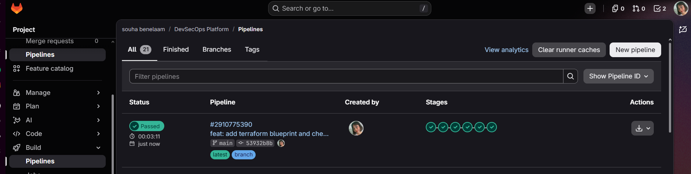
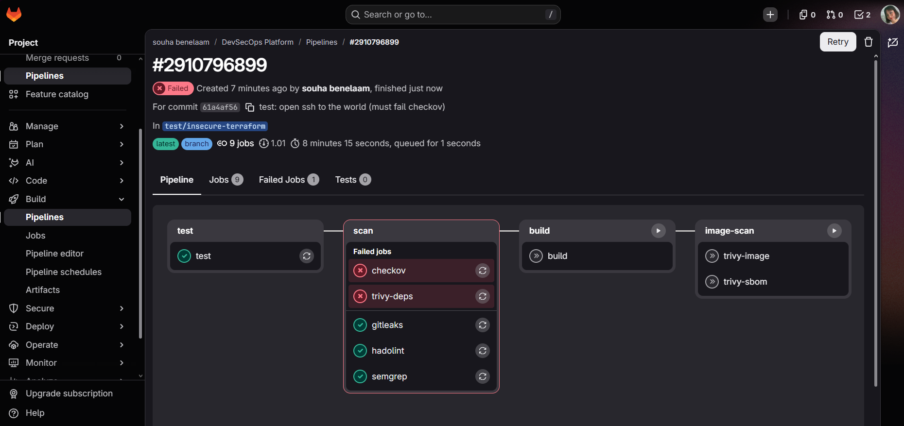
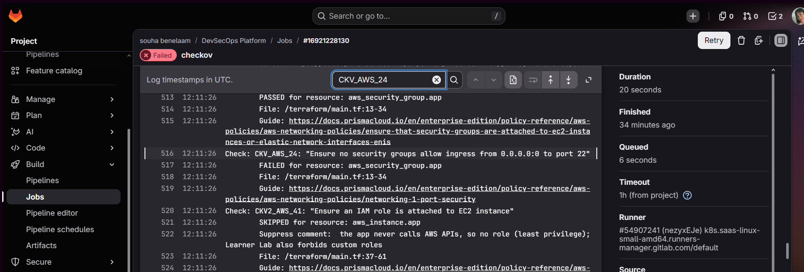

# Phase 7: Terraform and infrastructure scanning

Infrastructure is now described as code, in `terraform/`, and scanned by the same pipeline
as the application. Nothing is created on AWS in this phase: the goal is to check the
blueprint before anything exists.



## What the blueprint describes

| Resource | Purpose |
|---|---|
| `aws_security_group.app` | Firewall. Inbound: TCP 8000 from **one IP only** (`/32`). Outbound: HTTPS only |
| `aws_instance.app` | One small server (`t3.micro`, Amazon Linux 2023) |

No load balancer, NAT gateway or Kubernetes on AWS: they cost money and the Learner Lab
budget is limited.

| File | Role |
|---|---|
| `versions.tf` | Pins Terraform (`>= 1.9`) and the AWS provider (`~> 6.0`) |
| `variables.tf` | Region, instance size, allowed IP |
| `main.tf` | Firewall and server |
| `terraform.tfvars.example` | Template for the allowed IP |
| `.terraform.lock.hcl` | Exact provider version and hashes, committed for reproducible runs |

## Hardening choices

- **Allowed IP is a variable with a validation.** Terraform itself rejects `0.0.0.0/0` or
  anything that does not end in `/32`.
- **The real IP stays local.** `terraform.tfvars` is in `.gitignore`; only the example
  file with a documentation address is committed.
- **IMDSv2 only** (`http_tokens = "required"`), which blocks the classic SSRF credential theft.
- **Encrypted root disk, detailed monitoring, EBS optimized.**
- **Egress limited to HTTPS** instead of "all traffic".
- **State files are never committed** (`*.tfstate` can contain secrets).

## The scan

The `checkov` job now runs three frameworks:

```
checkov -d . --framework dockerfile --framework kubernetes --framework terraform --compact
```

Result on `main`: Dockerfile 92 passed, Kubernetes 104 passed, Terraform 15 passed and
1 skipped, 0 failed.

### One documented skip

| Check | Why skipped |
|---|---|
| `CKV2_AWS_41` (attach an IAM role to the instance) | The app never calls AWS APIs, so a role would only add permissions it does not need. The Learner Lab also forbids custom roles |

The reason is written next to the resource in `main.tf` and printed in the job log.

## Proof that the gate works

On a throwaway branch, the firewall rule was changed to open **SSH (port 22) to the whole
internet**. The pipeline stopped in the `scan` stage: `build` and `image-scan` never ran.





Checkov reported `CKV_AWS_24` ("no security group allows ingress from 0.0.0.0:0 to port 22")
as failed on `aws_security_group.app`, with 14 other checks passing. The branch was deleted
afterwards.

`trivy-deps` also shows red in that run. The cause was a timeout while downloading
Trivy's vulnerability database, not a finding; it passes on `main`.

## What is not done yet

- `terraform plan` needs AWS credentials, so it waits for the AWS phase. For now
  `terraform validate` and `terraform fmt -check` are used locally.
- `apply` and `destroy` will run once from the local machine in the AWS phase.
