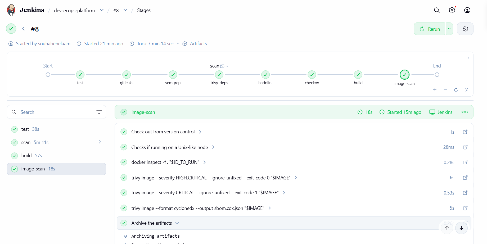
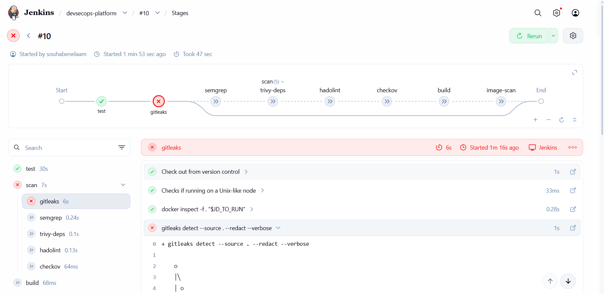

# Phase 7b: Jenkins

The same checks as the GitLab pipeline, rebuilt as a `Jenkinsfile` and run by a local
Jenkins server. Jenkins is triggered by hand ("Build Now"); GitLab CI stays the main pipeline.



## Setup

Jenkins runs in Docker, built from `jenkins/Dockerfile`:

| Piece | Choice | Why |
|---|---|---|
| Base image | `jenkins/jenkins:2.580.1-lts-jdk21` | Pinned LTS version |
| Docker CLI | Copied from `docker:27-cli` | Each tool runs in its own container, started through the host Docker |
| Plugins | `jenkins/plugins.txt`: pipeline, git, docker-workflow, credentials-binding, pipeline-graph-view | Only what the pipeline needs; the wizard's default plugin set is skipped |
| User | root | Needed to use the Docker socket. Accepted for a local lab, with a documented Checkov skip (`CKV_DOCKER_8`) |
| Healthcheck | `curl /login` | `docker ps` shows `(healthy)` |

```
docker build -t devsecops-jenkins:2 jenkins
docker run -d --name jenkins --restart unless-stopped \
  -p 127.0.0.1:8081:8080 \
  -v jenkins_home:/var/jenkins_home \
  -v /var/run/docker.sock:/var/run/docker.sock \
  devsecops-jenkins:2
```

- The port is bound to `127.0.0.1`, so Jenkins is not reachable from the network.
- `jenkins_home` is a volume: jobs, users and credentials survive a container swap.
- The unlock password comes from `docker logs jenkins` on first start.
- Mounting the Docker socket gives Jenkins control of the host Docker. That is the reason
  for the localhost-only binding.

Because of RAM limits (8 GB), the GitLab runner and the kind cluster are stopped while
Jenkins runs.

### Job configuration

| Setting | Value |
|---|---|
| Type | Pipeline, "Pipeline script from SCM" |
| Repository | the GitLab project over HTTPS |
| Credentials | GitLab **deploy token with only `read_repository`**, stored in Jenkins (ID `gitlab-read`) |
| Branch | `*/main` |
| Script path | `Jenkinsfile` |

The token can read the code and nothing else (least privilege). It is never in the repo.

## Stages

| Jenkins stage | GitLab job | Tool |
|---|---|---|
| test | `test` | pytest, 90% coverage gate |
| scan: gitleaks | `gitleaks` | Gitleaks v8.21.2 |
| scan: semgrep | `semgrep` | Semgrep 1.179.0 |
| scan: trivy-deps | `trivy-deps` | Trivy 0.75.0 |
| scan: hadolint | `hadolint` | Hadolint v2.15.1 |
| scan: checkov | `checkov` | Checkov 3.3.22 |
| build | `build` | `docker build`, image kept local |
| image-scan | `trivy-image`, `trivy-sbom` | Trivy, then archives `sbom.cdx.json` |

Same tools, same pinned versions, same thresholds. Each tool runs in a throwaway container
(`agent { docker { image ... } }`). A named volume (`trivy-cache`) keeps Trivy's
vulnerability database between runs.

### Not ported, on purpose

- **Registry push and `latest` tag:** would need a write credential for the GitLab registry.
  The image is built and scanned locally instead.
- **Kubernetes deploy:** needs the kind cluster, which does not fit in RAM next to Jenkins.
  The deploy already works in GitLab.

## Proof that the gate works

A throwaway branch added a file with fake AWS keys. The Jenkins job was pointed at that
branch for one run.



`gitleaks` failed after 6 seconds and every later stage was skipped, so no image was built.
The branch was deleted and the job pointed back to `main`.

## Problems met along the way

| Problem | Cause | Fix |
|---|---|---|
| `Access denied` on the first build | Wrong deploy-token credentials | Recreated the token and updated the credential |
| `Invalid option type "timestamps"` | Timestamper plugin not installed | Removed the option |
| `variables have some issues: IMAGE` | Image name used the commit ID before any code was checked out | Set the name in the `build` stage |
| `short read ... unexpected EOF` | Image download cut off by an unstable connection | Pre-pulled the images with retries |
| Checkov failed in GitLab after adding `jenkins/Dockerfile` | `USER root` and no `HEALTHCHECK` | Added a healthcheck, documented skip for root |
| `invalid refspec` | Backslashes typed in the branch name | Used `*/branch-name` |

## GitLab CI vs Jenkins

| | GitLab CI | Jenkins |
|---|---|---|
| Pipeline file | `.gitlab-ci.yml` (YAML) | `Jenkinsfile` (Groovy) |
| Where it runs | Built into GitLab | Separate server to install, update and secure |
| Setup effort | Almost none | Image, plugins, credentials, job |
| Credentials | CI variables in the project | Jenkins credential store |
| Trigger | Automatic on push | Manual here (automatic would need GitLab to reach this PC) |
| Strength | Simple, tightly integrated with repo and registry | Very flexible, huge plugin ecosystem |
| Cost of flexibility | | Plugins and the server itself become something to maintain and protect |
