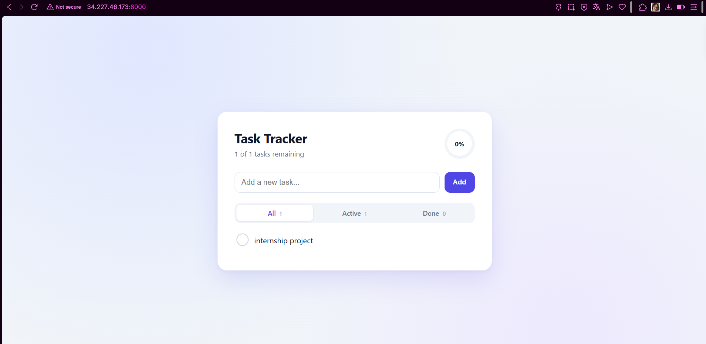
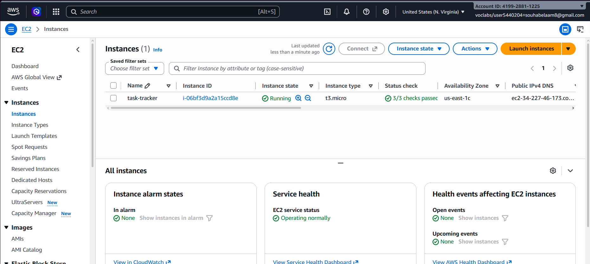
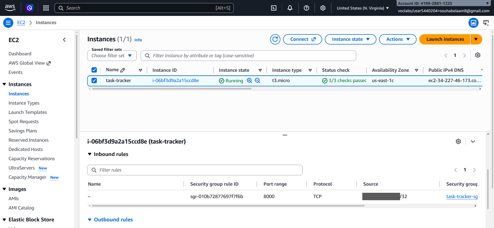

# Phase 8: Deploying to AWS

The Terraform blueprint from phase 7 was applied once on an AWS Academy Learner Lab account.
A real server started, pulled the image the pipeline had built and scanned, and ran it.
Everything was destroyed in the same sitting.

## How the app gets onto the server

The server has no SSH. Opening port 22 to the internet would be a real risk, and Checkov
rightly blocks it (see phase 7). Instead, Terraform attaches a **first-boot script**
(`terraform/user_data.sh.tftpl`) that the server runs once when it starts:

1. Install and start Docker.
2. Log in to the GitLab registry with a read-only deploy token.
3. Pull the image **by digest** (`name@sha256:...`), then log out.
4. Start the container with the same hardening as in Kubernetes.

| Container setting | Effect |
|---|---|
| `--user 10001:10001` | Not root |
| `--read-only` + `--tmpfs /tmp` | Image files cannot change, only `/tmp` and `/data` are writable |
| `--cap-drop ALL` | No special Linux powers |
| `--security-opt no-new-privileges` | No privilege escalation |
| `--memory 256m` | Hard memory ceiling |
| `-v tt-data:/data` | Volume for the SQLite database |
| `--restart unless-stopped` | Comes back after a reboot |

The image is the exact one the pipeline deployed to kind: the digest was read from the
running pod, so the same bytes ran in both places. Terraform refuses an `image` value that
is not pinned by digest.

## The registry token

The registry is private, so the server needs a `read_registry` deploy token (it can only
download). How it was handled:

- `registry_token` is a `sensitive` Terraform variable, set through the environment variable
  `TF_VAR_registry_token`. It is never in git, in a file or in a chat.
- The AWS credentials of the Lab were also typed hidden into a local script and only lived
  in that PowerShell window.

**Known limit.** The token still ends up in the Terraform state and in the instance's boot
data. This was accepted because the token is read-only and the server lived for a few
minutes. After the destroy, the leftover state backup was deleted. In production the fix is
to fetch the token from a secrets manager at boot with an instance role, which the Learner
Lab does not allow.

## Run

```
terraform init
terraform plan -out=tfplan     # 2 to add, 0 to change, 0 to destroy
terraform apply tfplan         # prints app_url
```

The plan showed exactly two resources, the security group and the instance. About two
minutes after the apply the app answered on the printed address.

Checks done on the live server:

- The Task Tracker page loads, a task can be added.
- `/health` returns `status: ok`.





The firewall rule: TCP 8000, source a single `/32` address (blurred here). Nobody else on
the internet can reach the app.



## Cleanup

```
terraform destroy              # 2 destroyed
```

`Destroy complete! Resources: 2 destroyed.` The server, its disk and the firewall are gone,
so nothing keeps using the Lab budget.

## Limits of this setup

| Limit | Why | What production would do |
|---|---|---|
| Plain HTTP (browser shows "Not secure") | HTTPS needs a certificate, which needs a domain name. The Lab has only a raw IP | Domain, then an HTTPS load balancer or a reverse proxy with a Let's Encrypt certificate, HTTP redirected to HTTPS |
| Token in state and boot data | Lab forbids instance roles | Secrets manager plus an instance role |
| Data on the server's own disk | Demo only | Managed database or backed-up volume |
| One server, no redundancy | Cost and scope | Several instances behind a load balancer |
| Deployed by hand from a PC | Lab credentials are temporary and per session | Pipeline with short-lived credentials (OIDC) |
